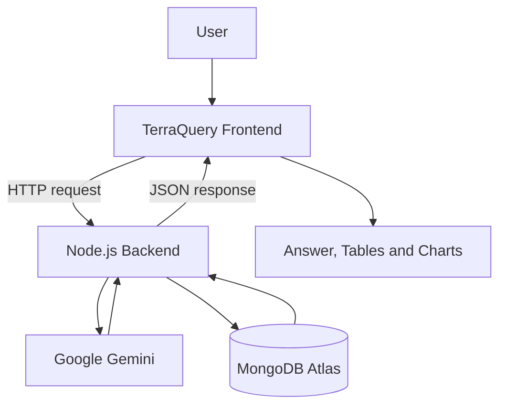

# TerraQuery — Architecture

## 1. Overview

TerraQuery is a natural-language rainfall and climate-data analytics application. It is intended to let users ask questions in everyday language and explore available data through answers, tables, charts, and district comparisons.

**Technology stack**
- **Frontend:** Existing TerraQuery web interface (confirm framework and build setup from `package.json`).
- **Backend:** Node.js server (`server.js`).
- **AI provider:** Google Gemini.
- **Database:** MongoDB Atlas.
- **Backend health endpoint:** `GET /api/health`.
- **Query endpoint:** `POST /api/query`.

> This document reflects the known project setup. Confirm exact implementation details against the current source code before treating optional components or flows as verified.

## 2. High-Level Architecture



## 3. Component Responsibilities

### Frontend
The frontend provides the user interface for entering natural-language questions, navigating application sections, and viewing returned results.

Expected sections include:
- Dashboard
- Explore Data
- Analytics
- Architecture
- Query History
- About

The frontend should display loading, empty, and error states clearly. Visualizations must use the fields and metric returned by the backend response instead of assuming every query returns the same field name.

### Backend
The Node.js backend receives frontend requests and coordinates query processing and data retrieval.

Known API routes:
- `GET /api/health` — health/status check.
- `POST /api/query` — query submission.

The exact request and response schemas should be read from the current server implementation and frontend API service before making changes.

### Google Gemini
Google Gemini is the configured AI provider. It supports interpretation of natural-language questions and query/visualization generation as implemented by the backend.

Gemini output should be validated before it is used to access data or render charts. The application should not invent values when the model response or database results are missing.

### MongoDB Atlas
MongoDB Atlas stores the data queried by the backend. The actual collection names, document schema, rainfall fields, location coverage, time range, and units must be confirmed from the database and backend query code.

## 4. Query Lifecycle

1. The user enters a question in the TerraQuery frontend.
2. The frontend sends a request to the backend query endpoint.
3. The backend processes the request and uses Google Gemini where required by the current implementation.
4. The backend retrieves the relevant records from MongoDB Atlas.
5. The backend prepares the response, including any supported visualization metadata.
6. The frontend receives the response and renders the answer, tables, or charts.
7. If a step fails, the frontend displays a useful error rather than a fake successful result.

## 5. Example Use Case: District Rainfall Comparison

Example question:

> Compare rainfall between Durg and Raipur.

Expected flow:
1. Frontend submits the question to `POST /api/query`.
2. Backend interprets the request using the configured query workflow.
3. Backend retrieves matching rainfall records from MongoDB Atlas.
4. Backend returns records and, if provided, visualization metadata such as a title and metric name.
5. Frontend maps the returned metric to the chart values and labels the districts correctly.

**Important:** Do not assume that the metric is always named `Daily Actual`. The frontend should use the metric specified in the visualization response when available and validate missing or nonnumeric values. A missing metric must not silently appear as a genuine `0.00` rainfall value.

## 6. API and Local Development

Known local development details:
- Backend port: `5000`.
- Health check: `http://localhost:5000/api/health`.
- Query endpoint: `POST http://localhost:5000/api/query`.

Run the backend from the project directory containing `server.js`:

```bash
node server.js
```

Run the frontend in a separate terminal using the command defined in the project's `package.json`, commonly:

```bash
npm run dev
```

Use the frontend URL printed by the development server. Do not start multiple backend instances on port `5000`; an `EADDRINUSE` error means that port is already occupied.

The frontend API base URL, Vite proxy (if used), and CORS allowlist must agree with the actual local frontend and backend addresses.

## 7. Error Handling and Reliability

The application should handle:
- Backend not running or unreachable.
- Incorrect frontend API URL.
- CORS or request configuration errors.
- Invalid or unsupported queries.
- Gemini errors or malformed model output.
- MongoDB connection or query errors.
- Empty query results.
- Missing, nonnumeric, or unexpected visualization fields.

Errors should be clear and should not be hidden by mock data. Keep credentials in backend environment variables; do not expose secrets in frontend code, documentation, screenshots, or committed files.

## 8. Security Considerations

- Keep Gemini API keys and MongoDB Atlas credentials in environment variables on the backend.
- Do not commit `.env` files containing secrets.
- Validate user input and AI-generated query instructions before executing database operations.
- Return only data required by the frontend.
- Avoid logging credentials or sensitive connection strings.

## 9. Architecture Decisions and Constraints

- Use Google Gemini and MongoDB Atlas as the stated AI and database technologies.
- Keep frontend and backend responsibilities separate.
- Preserve existing API contracts unless a verified defect requires a minimal change.
- Base charts on actual backend data and returned visualization metadata.
- Do not claim that query history is persistent, data is real-time, or forecasts are supported unless verified in the code and dataset.

## 10. Items to Verify in the Codebase

Before treating this architecture document as a complete implementation map, confirm:
- The frontend framework and exact source entry points.
- All routes and request/response schemas.
- MongoDB collections, fields, rainfall units, and data coverage.
- Whether query history is stored persistently or only in frontend state.
- Which charts, maps, filters, and analytics are implemented.
- Production hosting, authentication, and deployment configuration.

---
**Project:** TerraQuery  
**Document:** `architecture.md`
